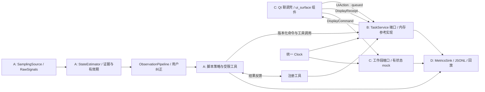

# M0 操作与验收

M0 是四人协作联调底座：有状态内存 TaskService、保留诊断页的 Qt 窗口、可嵌入的 C 界面、脚本决策、工作段 mock 和 JSONL 回放。入口独立于旧桌宠。

## 启动

```bash
uv sync --python 3.12 --extra dev --locked
uv run --offline python -m deskpet.m0 examples --check
uv run --offline python -m deskpet.m0 replay --suite m0 --output output/m0/replay
uv run --offline python -m deskpet.m0 gui --profile scenario --output output/m0/gui
```

GUI 录入结构化事项与延时/窗口，创建草稿后确认。scenario 时间只在按快进或回放输入时推进，不需要真实等待。主闭环不调用模型、截图或真实桌面信号。

```bash
# 原生 Qt 自动操作与绘制回执
uv run --offline python -m deskpet.m0 gui --profile scenario --auto-smoke --output output/m0/native
# 显式开启真实桌面采样；仍不调用真实模型
uv run --offline python -m deskpet.m0 smoke --profile live-smoke --output output/m0/live
```

原生自动 smoke 要求已解锁的交互式桌面，并在验收期间保持联调窗口可见且未遮挡。显式启动会激活一次窗口，普通后台刷新不抢焦点；报告记录启动时 active/exposed 前提。截图重绘不会生成展示回执。

live-smoke 使用 RealClock，要求 Windows/macOS 原生 QApplication；offscreen/minimal 明确不支持。缺权限输出能力与 unknown，不回退假桌面冒充实测。

## 替换你的模块

[接口与工厂](contracts/interfaces.md)规定所有者与注入方式。用 `--adapters adapters.json` 指定自己的 task_service、work_sessions、metrics、sampling_source、state_estimator、ui_surface 工厂，或替换完整 gui 入口；先单独替换一个角色，再运行同一回放和 GUI。正式类型与 mock 共用契约。

- [B：任务服务](handoff/b-task-service.md)
- [C：GUI 与工作段](handoff/c-gui-work-sessions.md)
- [D：事件与评估](handoff/d-evaluation.md)
- [Windows agent](handoff/windows-agent.md)

## 验收证据

本轮 C 界面插槽的报告放在 `output/m0/ui-surface-acceptance/`：staged-pytest.log、summary.json、native-final/native-gui-report.json 及截图与 JSONL。报告和截图为本机产物，不作为源码提交。

2026-11-10 Observation 扩展的历史本机报告放在 `output/m0/observation-acceptance/`：pytest-final.log、summary.json、replay/report.json、observe/observation-report.json、native/native-gui-report.json、live/native-gui-report.json 及截图与 JSONL。首版历史报告保留在 `output/m0/acceptance/`。历史报告的源码指纹只对应当时版本。原生自动检查与人工体验核验分开。Windows 报告由用户机器上的 agent 回传前保持待验收。

回放只证明合成输入上的状态和事件顺序；模拟回执不能作为原生展示证据；自动 GUI 通过不等于所有人工体验均已审阅。M0 不含跨进程任务持久化，SQLite 恢复由 B 接入后验收。

macOS 当前沙箱限制可能使 Qt 导入出现 neon/CPU 特征检测 abort。使用允许原生系统查询的受控环境执行 Qt 检查；无需为此升级锁文件依赖。测试中的 offscreen 环境只作用于测试进程，原生 smoke 应单独启动。


## Observation 独立联调

```bash
uv run --offline python -m deskpet.m0 observe --input docs/contracts/raw-example.json --output output/m0/observe
uv run --offline python -m deskpet.m0 gui --profile scenario --output output/m0/observation-gui
```

界面新增 Observation 页，分别显示原始样本、基础估计、有效状态和用户纠正。原始信号注入、估计器替身调试、用户纠正三个入口独立，Observation 页也提供虚拟时钟快进；清除纠正和推进到期不会重写采样时间。`--advance 30` 可在独立 observe 中复现原始样本到期，CLI 报告过期并返回非零；回放场景则以 expected_outcomes 验证降级是否正确。

使用 `sampling_source`、`state_estimator` 工厂分别替换，签名均为 `factory(*, clock)`。原生采样在 GUI 主线程，估计与纠正在服务线程；采样错误经过 Buffer 显式变成 unknown，而不会继续冒用旧状态。参见 [观察契约](contracts/observation.md)、[A 观察交接](handoff/observation.md) 与 [ADR-0006](adr/0006-observation-pipeline.md)。

## C 界面与工作段联调

```bash
uv run --offline python -m deskpet.m0 gui --profile scenario --adapters examples/m0/c-ui.adapters.json --output output/m0/c-embedded
```

样例配置把 `deskpet.m0.example_surface:create_surface` 装入「C 界面 · 实际展示」页，原任务与工作段页、Observation 和日志仍可查看。C 页的开始、暂停、继续、结束操作使用同一工作段服务；在一个界面操作后，另一个界面会显示相同的 session_id、版本和剩余时间。在 C 页填写的成果与下一步会随结束命令保存为回顾。

在诊断页创建并确认 hard 提醒，快进至到期，联调台会切到 C 页展示提醒卡。成功绘制和完成按钮分开记录；该模式下默认页不再生成第二张正式提醒卡。普通状态刷新不会切页或激活窗口。

接入自己的代码时，在 adapters.json 中分别指定 `work_sessions: "c_sessions:factory"` 和 `ui_surface: "c_ui:create_surface"`。两项可独立替换；组件工厂为 `create_surface(*, context, parent) -> QWidget`，无需修改公共装配代码。它通过快照副本和 queued UiAction 访问后端。原 `gui` 配置用于整体替换窗口入口，GUI 命令不能与 ui_surface 同时配置。离线 replay 不加载界面模块。[组件接口](contracts/gui-work.md) · [C 的接手与验收步骤](handoff/c-gui-work-sessions.md) · [ADR-0007](adr/0007-embedded-ui-surface.md)

## 依赖与替换示意



## 2026-11-11 C 界面插槽验收

- 从 Git 暂存区导出独立源码后执行全量 pytest：245 passed，包含 4 项新增组件集成测试。该快照未包含工作区中另两项 macOS 桌宠测试及其他旧桌宠改动，验证此次提交可独立运行。
- 新增测试覆盖自定义工作段工厂与组件同时加载、暂停期间计时不消耗、继续和用户回顾双向同步、提醒唯一展示、点击完成、旧动作和未知/隐藏/截图/过期/重复回执拒绝、组件失败和销毁、关闭上下文，以及 headless 不加载界面模块。
- 同一暂存源码的 macOS 原生 scenario：29 项自动检查通过，C 组件为唯一正式投递端，2 条 native 展示回执，无错误。源码指纹见报告中的 source_sha256。
- [测试日志](../output/m0/ui-surface-acceptance/staged-pytest.log)、[原生检查](../output/m0/ui-surface-acceptance/native-final/native-gui-report.json)、[C 页截图](../output/m0/ui-surface-acceptance/native-final/c-ui-surface.png)。
- 本轮未运行 Windows；真实平台覆盖仍等待 Windows agent。固定组件样例不等于 C 后续的正式动态 renderer 或桌宠外观实现。

## 2026-11-10 Observation 扩展验收（历史基线）

- 全量 pytest：243 passed；固定回放：20/20；公共样例：24；导出 Schema 与代码一致。
- 独立 observe：原始样例为 fresh，规则估计 available，无需任务服务、Qt 或模型。
- macOS 原生 scenario：29 项检查通过，覆盖原始信号到估计、用户纠正优先、清除恢复、原始样本到期和纠正到期；原生回执 2 条。
- macOS live-smoke：18 项检查通过；原始样本 source=live、raw_status=fresh，前台应用、空闲时间、窗口及光标能力可用。input_activity 不可用，截图、剪贴板和按键内容未采集；原生回执 3 条。
- 回放、独立 observe、原生 scenario、live-smoke 与当时源码指纹一致：`0c410f25027fcd6189cd59450118a151a2c31ce9928f36ff5f2967e375c87974`。
- [汇总报告](../output/m0/observation-acceptance/summary.json)、[全量测试](../output/m0/observation-acceptance/pytest-final.log)、[回放](../output/m0/observation-acceptance/replay/report.json)、[独立观察](../output/m0/observation-acceptance/observe/observation-report.json)、[原生 GUI](../output/m0/observation-acceptance/native/native-gui-report.json)、[真实采样](../output/m0/observation-acceptance/live/native-gui-report.json)。
- Observation 页截图已作可读性审阅；完整人工焦点/输入体验仍为 pending。Windows 执行包已同步独立 observe 与 Observation 人工核验说明，平台验收仍待 Windows agent 回传。

## 2026-11-10 首版交付记录（历史基线）

- 全量 pytest：188 passed（含既有桌宠测试与新增 M0 测试）。
- 固定场景：17/17；公共样例：19；导出 Schema 与代码一致。
- macOS 原生 scenario 自动检查：16 项通过；live-smoke：17 项通过。启动时 active/exposed 均为 true，回执来源为 native。
- 首版三份运行报告与当时源码指纹一致：`1e48c696b5ed1456fe42e8361b8f9792a8a286409743465466ac11ef2c94fd70`。
- [汇总报告](../output/m0/acceptance/summary.json)、[pytest](../output/m0/acceptance/pytest.log)、[回放](../output/m0/acceptance/replay/report.json)、[原生 GUI](../output/m0/acceptance/native/native-gui-report.json)、[真实感知](../output/m0/acceptance/live/native-gui-report.json)。输出报告属于本机验收产物，向 Windows agent 交接时请同时提供汇总以比较指纹。
- 初次 live-smoke 发现的窗口遮挡/截图诱发回执问题已修复，原失败证据保存在 output/m0/acceptance/live-first-failure；最终报告采用修复后重跑结果。
- Windows 尚待用户机器执行并回传；人工焦点/输入体验仍为 pending；SQLite 跨进程恢复待 B 的正式实现。
